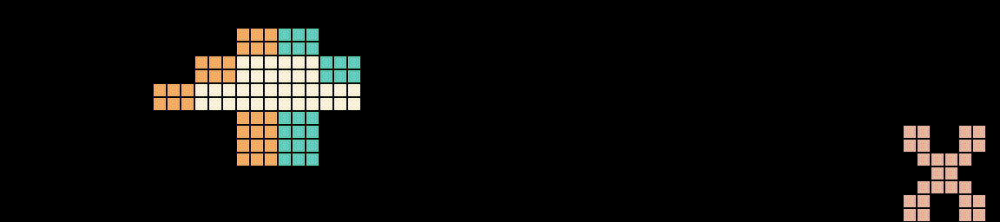
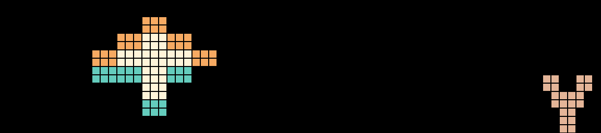

# Light Table

Align two small pixel-animation masks on the front screen using an onion-skin comparison.

A one-pixel shift is easier to judge when the two silhouettes share a grid. Amber shows the reference, teal shows the moving mask, and pale pixels show where both occupy the same cell.

## Register two animation frames

1. Enter the two masks in device settings as slash-separated rows of zeros and ones. A mask may have up to 12 columns and seven rows.
2. Watch the axis letter on the right. Turn the wheel to translate the moving mask one cell on that axis, then click to switch between X and Y.
3. Read the offsets and overlap count on the rear. The first clip shows the colored edges shifting relative to one another.



## Inspect each silhouette

1. Press **Start** to isolate the amber reference. Press it again for the teal moving frame.
2. Press **Start** once more to return to the overlay. Comparing the isolated silhouettes helps tell a misplaced pixel from a deliberate shape change.
3. Hold **Start** to zero both offsets if you want to try aligning the frames from the original position.



## Example from the emulator

For a tiny three-row cross, enter `010/111/010`. Use two matching copies to see a fully overlapping cross at zero offset, then turn once and look at the two exposed edges. The moving layer can shift independently along either axis.

## Run in the emulator

Open BUSY Bar Emulator. From this repository, run:

```sh
~/.busy-emulator/bin/busy-emulator dev --once
```

Press **Back** to exit.

The GIFs are excerpts from the emulator recording. Each front-display pixel is shown at 9× its original width and height. The end frames pause for reading.

[Full recording](media/controls.mp4) · [Rear display](screenshots/back-1.png) · [Firmware test](EMULATOR-QA.md) · [MIT license](LICENSE)

## Device settings

Open **Apps → Light Table → Setup**. Save the fields and reopen the app to use the new values.

- **Reference binary mask** (`first`). Default: `00100/01110/11111/00100/00100`.
- **Moving binary mask** (`second`). Default: `00010/00111/01111/00010/00010`.
