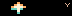

# Light Table

Align two small pixel-animation masks on the front screen using an onion-skin comparison.

Set each mask in device settings as slash-separated rows of 0s and 1s, up to 12 columns and 7 rows. Amber and teal are the original layers, and pale pixels mark overlap. Wheel shifts the second mask on the selected axis. Click switches X/Y. Start cycles overlay and single-layer views. Hold Start resets the offset.

## Run locally

From this folder, run `~/.busy-emulator/bin/busy-emulator dev --once` with BUSY Bar Emulator open. Back exits.

